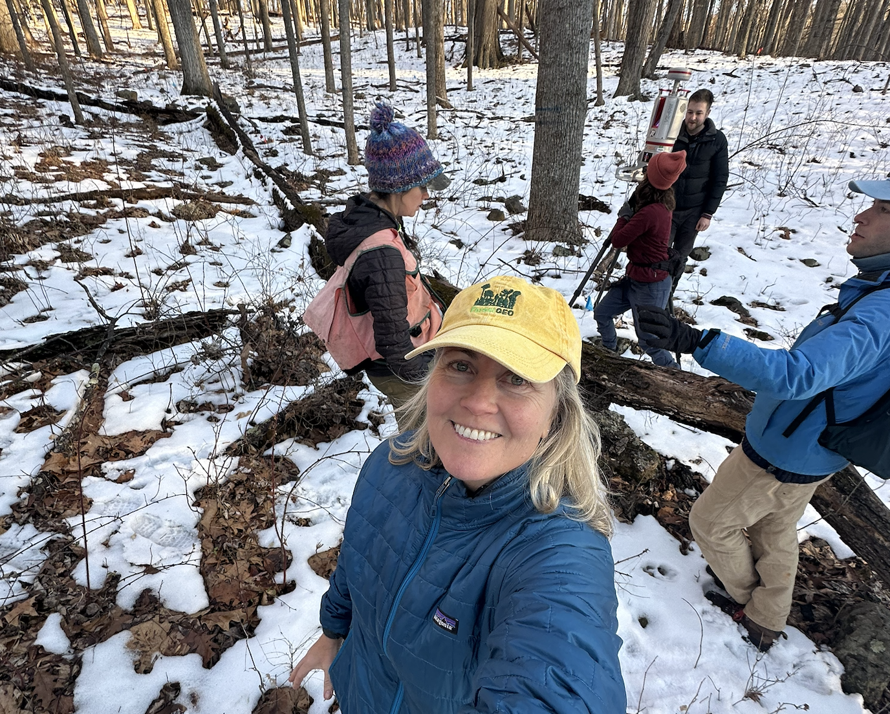

---
title: "Jen Jordan"
title-block-banner: false
page-layout: full
---

::: {.hero-banner}
# Forests, climate extremes, and carbon dynamics
:::

::: {.homepage-content}

:::: {.columns}

::: {.column width="35%"}

{width=100%}

:::

::: {.column width="65%"}

## Jen Jordan

**PhD Candidate, Environmental Science and Policy**  
George Mason University

**Predoctoral Fellow**  
Smithsonian Conservation Biology Institute  
ForestGEO Ecosystems and Climate Program

I investigate how climate extremes and disturbance affect tree growth, woody carbon accumulation, and the resilience of eastern U.S. temperate forests as carbon sinks.

My dissertation examines how extreme heat, atmospheric drought, and non-lethal tree damage constrain woody productivity, and whether canopy carbon uptake continues to translate into long-lived woody biomass under climate stress.

[Research](research.qmd) · [Publications](publications.qmd) · [Download CV](Jen_Jordan_CV.pdf) · [ORCID](https://orcid.org/0000-0001-5521-360X)

:::

::::

## Research Themes

**Climate Extremes and Forest Growth**

How the timing, duration, and persistence of extreme heat and atmospheric drought affect woody growth.

**Carbon Uptake and Woody Biomass**

When canopy carbon uptake and long-lived woody biomass accumulation diverge under climate stress.

**Forest Disturbance and Resilience**

How non-lethal crown damage influences tree growth and stand-level forest productivity.

[Learn more about my research →](research.qmd)

:::
