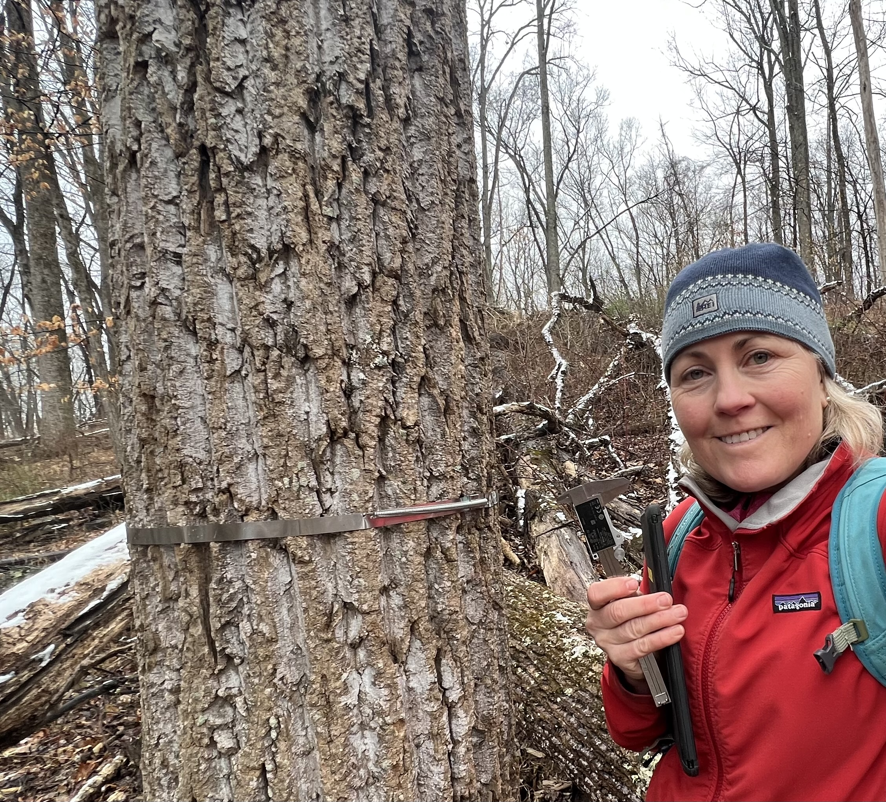

---
title: "Research"
page-layout: full
title-block-style: none
---

::: {.hero-banner}

# Research

:::

::: {.interior-content}

## Research Overview

:::: {.columns}

::: {.column width="65%"}

My research investigates how climate extremes and disturbance affect forest growth, woody carbon accumulation, and the resilience of eastern U.S. temperate forests as carbon sinks.

A central question motivating my work is whether forests experiencing increasing heat and atmospheric drought can continue to convert photosynthetically assimilated carbon into long-lived woody biomass.

My dissertation, *Hot-Dry Extremes, Disturbance, and Carbon Source–Sink Decoupling in Eastern Temperate Forests*, addresses this question through three complementary studies, integrating long-term forest observations, tree-ring and dendrometer measurements, flux-tower data, and remote sensing.

:::

::: {.column width="35%"}

{width=100%}

:::

::::

## Climate Extremes and Tree Growth

**How do the timing, duration, and persistence of heat and atmospheric drought influence woody growth?**

I investigate relationships between extreme heat, elevated vapor pressure deficit (VPD), compound hot-dry conditions, and tree growth across eastern U.S. ForestGEO sites.

Rather than relying exclusively on monthly or seasonal climate averages, I examine climate stress across multiple temporal windows to identify when trees are most sensitive to extreme conditions.

Preliminary analyses identify June–July as a particularly climate-sensitive period for woody growth, with stronger relationships associated with sustained heat and elevated VPD than with isolated short-duration extremes.

Ongoing work integrates tree-ring observations with biweekly manual dendrometer measurements and automated point-dendrometer records from the Smithsonian Conservation Biology Institute (SCBI) to better resolve within-season growth responses.

## Carbon Uptake and Woody Growth Decoupling

**Does canopy carbon uptake reliably translate into long-lived woody biomass under climate stress?**

Forests absorb atmospheric carbon dioxide through photosynthesis, but carbon uptake does not necessarily translate directly into wood production.

My research examines whether extreme heat and atmospheric drought alter the relationship between canopy carbon uptake and woody growth across eastern U.S. temperate forests.

This ongoing study integrates tree-growth observations, flux-tower measurements, and remote-sensing data to compare canopy productivity and woody biomass accumulation during climate extremes.

The objective is to identify conditions under which canopy carbon uptake and woody growth diverge, with implications for interpreting forest carbon sinks and improving ecosystem carbon-cycle models.

## Non-Lethal Crown Damage and Woody Productivity

**How does structural damage affect tree growth and forest productivity without causing immediate mortality?**

Storms and other disturbances can damage tree crowns without killing trees, potentially reducing woody growth and forest carbon accumulation.

Using long-term observations from the SCBI ForestGEO forest dynamics plot, I quantify the effects of non-lethal crown damage on individual-tree growth and stand-level aboveground woody productivity.

Analyses are complete, and a manuscript is currently in preparation with coauthors.

## Research Approaches

My work combines field-based ecological measurements with quantitative analyses across temporal and spatial scales.

- Long-term ForestGEO forest monitoring
- Tree-ring and woody growth analyses
- Manual and automated dendrometer measurements
- Tree mortality and structural damage observations
- Climate extremes and vapor pressure deficit metrics
- Flux-tower observations and remote sensing
- Forest productivity and carbon-cycle analysis

## Dissertation

*Hot-Dry Extremes, Disturbance, and Carbon Source–Sink Decoupling in Eastern Temperate Forests*

PhD in Environmental Science and Policy, George Mason University

Smithsonian Conservation Biology Institute — ForestGEO Ecosystems and Climate Program

:::
